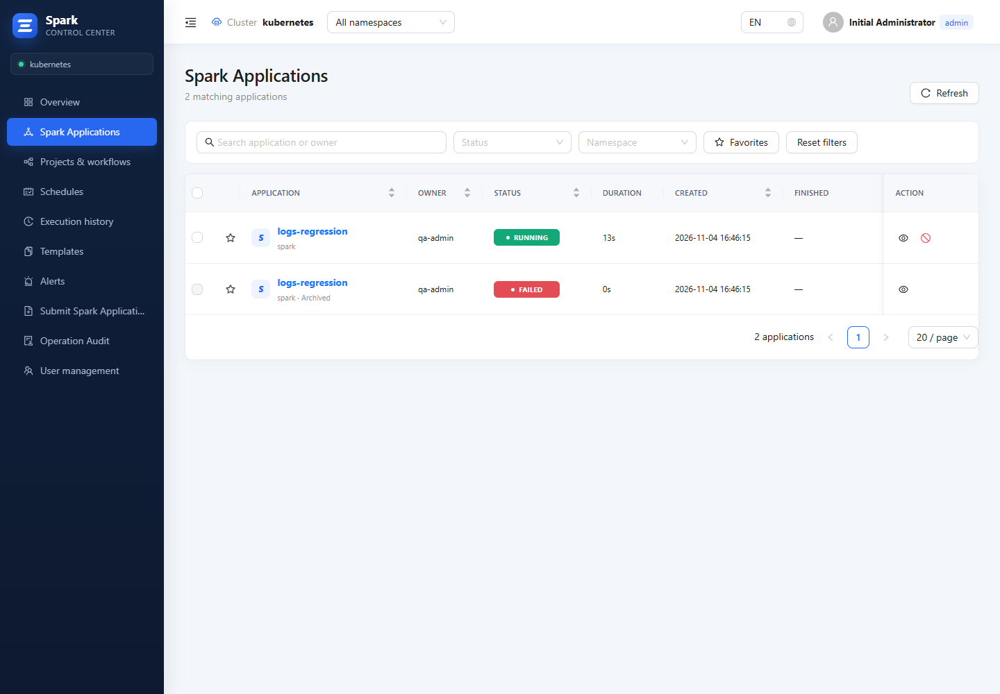
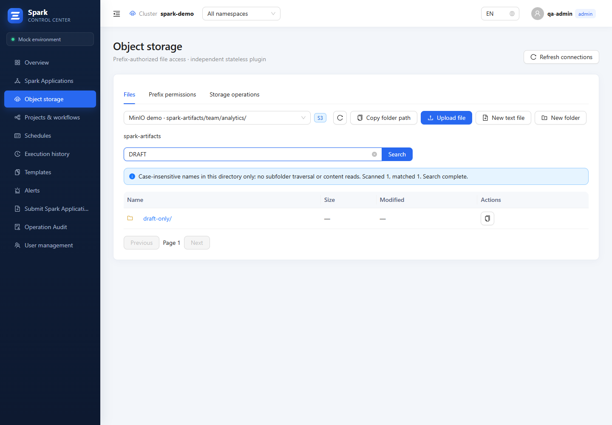
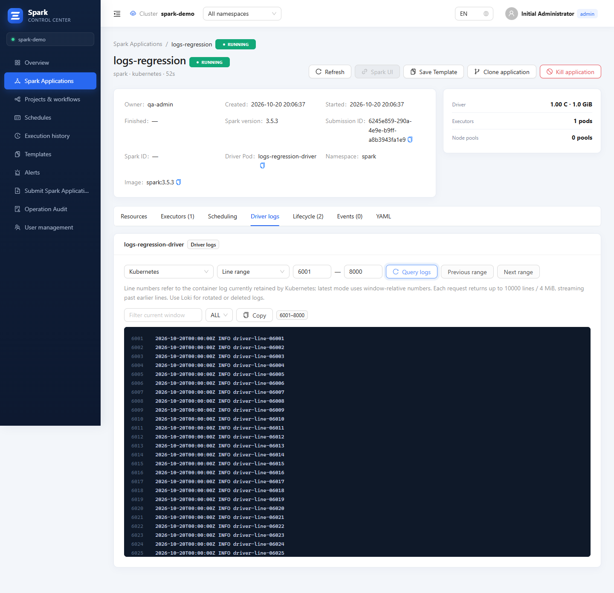

# Spark Control Center 1.5.3

Reliable termination of restarting applications, retained application instances, directory-wide storage search and security hardening.

## Application lifecycle and history

- Persist a stop request on the SparkApplication and disable automatic retries before setting the Driver deadline. A recovery loop also stops verified Drivers recreated by the Operator. The CR is retained; the console does not delete the Driver as its termination method. Older Operator versions can themselves delete the original Driver when a spec change triggers invalidation. Clone/retry creates a new application without the stop marker.
- Use Kubernetes application UIDs in detail URLs, including jobs that have not generated a Spark ID. Same-name applications recreated after deletion have separate records. Legacy name links resolve to the current or latest visible instance and then use its canonical UID URL.
- Merge archived PostgreSQL snapshots into the paginated application list. Archived entries show their last observed state and creation/completion times; they do not contribute to current dashboard resource totals. Stop, delete and live Spark UI access cannot target a same-name replacement through an archived UID.
- Keep observed manifests and existing diagnostic snapshots. Historical Loki/Prometheus queries stay within the observed instance lifetime. Kubernetes log windows are unavailable for archived instances; use the labeled saved tail or retained Loki logs. Data never observed or already expired in the source cannot be reconstructed.

## Object storage

- Search files and folders throughout the current directory, automatically skipping provider pages without matches. S3/MinIO and GCS use delimiter-aware listing and never traverse child prefixes. Requests remain bounded and cursors remain user/tenant/grant/query scoped.
- Add **Copy folder path** to the directory toolbar and folder rows, producing `bucket/prefix/`.
- Preserve prefix authorization, conditional writes, transfer budgets and lightweight read-only behavior.

## Security and performance

- Isolate Spark UI in an opaque sandbox with application/session-scoped PostgreSQL tickets, ownership-checked proxy targets, stripped credentials, bounded proxy responses and redacted ticket paths.
- Enforce fixed public origins, explicit OIDC callbacks, CSRF checks, shared authentication rate budgets and immutable tenant ownership of application history. Validate Pod ownership and UID/revision preconditions for lifecycle operations.
- Persist scheduler effects with leases and cancellation compensation. Deliver Webhooks through a transactional PostgreSQL outbox with retries, backpressure and delivery IDs. Receivers must deduplicate: delivery is at least once.
- Share storage concurrency/rate budgets across replicas, spool upload parts to bounded temporary disk, and use a shared Kubernetes LIST/WATCH reflector plus SQL pagination for application lists.
- Update vulnerable dependencies and publish bilingual hardening and source-derived API/configuration references.

## Upgrade

Back up PostgreSQL before upgrading and read the [hardening and migration requirements](https://github.com/ApolloMeridian/spark-application-webui/blob/v1.5.3/docs/en/HARDENING.md). This release adds automatic database migrations. Do not mix pre-hardening and upgraded backend replicas. Verify the fixed public URL/OIDC callback, Services `get` RBAC, storage `/tmp` mount and historical tenant assignments. Unknown legacy ownership is quarantined, not automatically shared or deleted. Remove the old backend replicas before starting the upgraded deployment.

Update all three image tags to `1.5.3`. No new required Helm setting is introduced. A stop marker remains attached to the same resource UID; use clone/retry for a new execution rather than editing that stopped resource in place. Stored snapshots contain operational data and follow the existing PostgreSQL backup/access policy.

## Product views

Release assets are the three images `spark-control-center:1.5.3`, `spark-control-center-backend:1.5.3`, `spark-control-center-object-storage:1.5.3` in separate TAR archives, plus `spark-control-center-1.5.3.tgz`. Images have no private registry prefix. No standalone checksum asset is generated.
