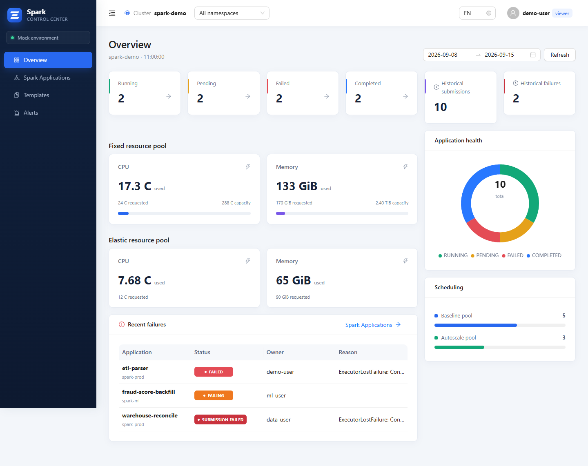

# Spark Control Center 1.5.4

The Overview separates fixed and elastic resource pools. Both panels show requests and observed usage from scheduled Spark Pods on their own nodes. The fixed pool also shows the sum of its Kubernetes allocatable CPU and memory. An idle elastic pool shows zero requests and zero usage.

The backend recognizes TKE supernodes and ACK virtual nodes by their labels and taints. A common label configuration works for these serverless pools and for GKE autoscaling node pools. Apply the labels to Kubernetes Nodes through the node pool configuration.

```yaml
overview:
  resourcePools:
    enabled: true
    autoDetectVirtualNodes: false
    fixedMatchLabels:
      capacity.example.com/pool: fixed
    elasticMatchLabels:
      - capacity.example.com/pool: elastic
```

Elastic rules take precedence when a node matches both pools. Each rule matches all its labels, and any matching elastic rule assigns the node to the elastic pool. Set `autoDetectVirtualNodes: true` to combine built-in detection with custom elastic labels. For GKE, a rule can match `cloud.google.com/gke-nodepool` directly.

Upgrade the Helm chart and images together. The chart grants the backend read-only `nodes/list` access through a dedicated role and binding. Installations with `rbac.create: false` need that permission in their existing RBAC. The Overview shows aggregate application metrics if the node inventory is unavailable.



The release includes the frontend, backend and object-storage image archives and the Helm chart.
