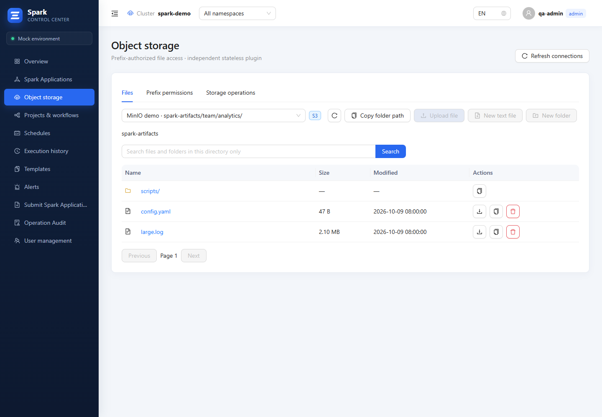

# Spark Control Center 1.5.5

- Restore Stage details and Executors navigation in the live Spark UI. View preferences use per-page memory inside the isolated iframe.
- Show `DELETED` for archived applications whose last observed state was active. Administrators can clear an archived snapshot from the application list or details. The audit identifies the removed UID.
- Copy full file paths in the form `bucket/prefix/object`. Sort the current directory by name, size or modification time. Numbered pages display the item count and offer 10, 20, 50 or 100 items per page and a jump field.
- Simplify storage search and keep Monaco's built-in Find and Replace shortcuts available.
- Build the backend and object-storage binaries with Go 1.26.11, which fixes the standard-library vulnerability GO-2026-6859.

Upgrade the frontend, backend and object-storage images together with the Helm chart. The release includes three image TAR archives and the Chart TGZ.
