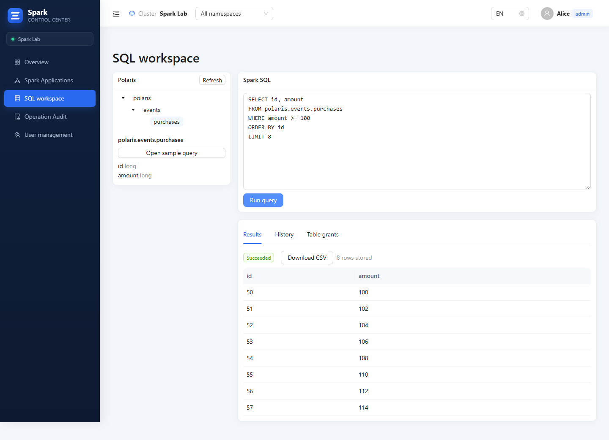

# Spark Control Center 1.6.0

- Optional SQL workspace for Kyuubi 1.11.0, Spark 3.5 and Polaris 1.6.0. Run read-only queries with per-user authentication, browse granted Iceberg schemas, cancel queries and view history.
- Tenant-scoped SELECT grants and query audits in PostgreSQL. Result pages and CSV come from a dedicated S3-compatible bucket, which can be backed by MinIO.
- Spark pod discovery now also recognizes native Spark application selectors, allowing resource accounting for executors whose application name differs from the SparkApplication resource name.
- Four unqualified container image archives and the Helm chart are attached. The SQL deployment is disabled by default.

The workspace requires a dedicated authenticated Kyuubi REST endpoint and a scoped Polaris identity per user. CSV contains the saved result within the configured budget. Catalog administration and fully materialized bulk exports remain separate.

[English SQL setup](https://github.com/ApolloMeridian/spark-application-webui/blob/v1.6.0/docs/en/SQL.md) · [SQL 部署说明](https://github.com/ApolloMeridian/spark-application-webui/blob/v1.6.0/docs/zh-CN/SQL.md)

