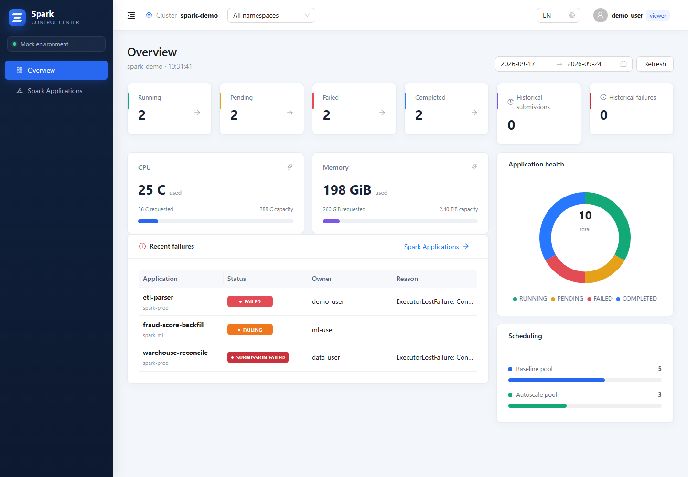
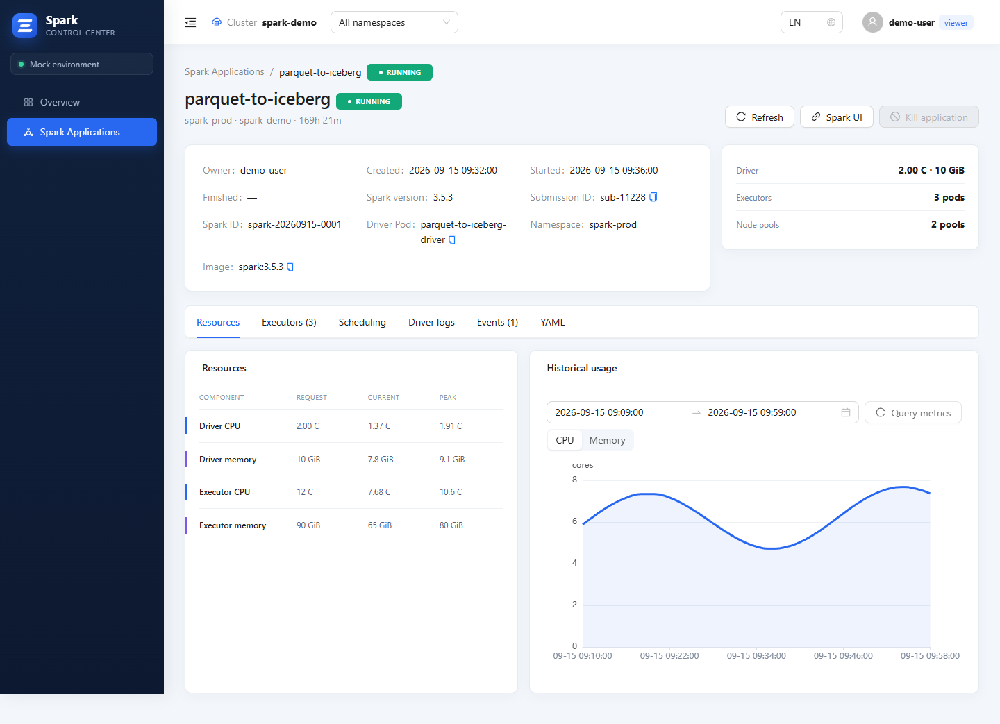
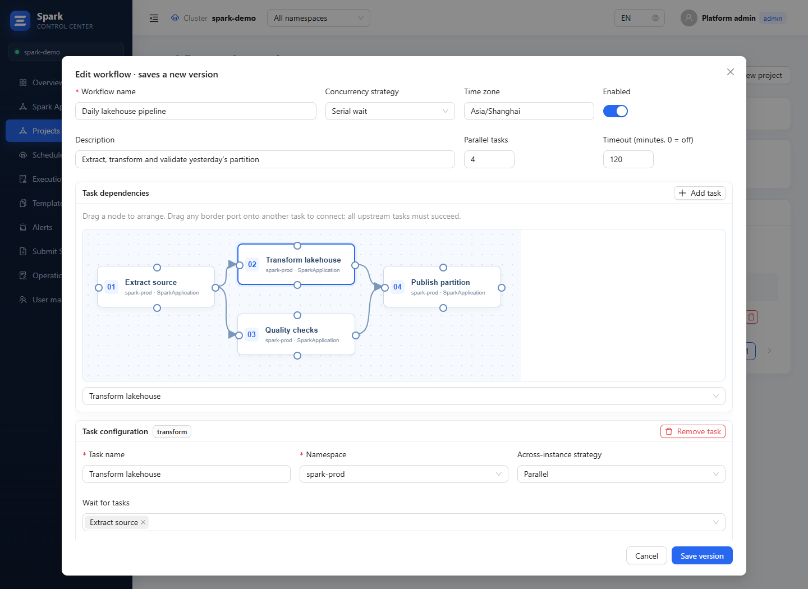
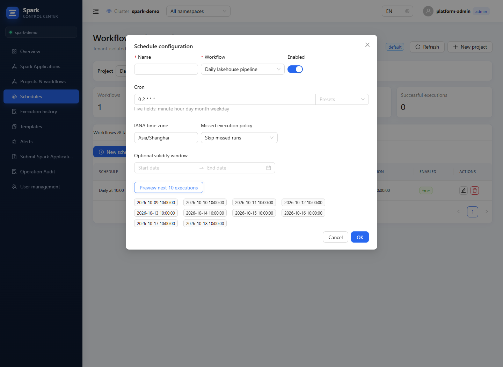
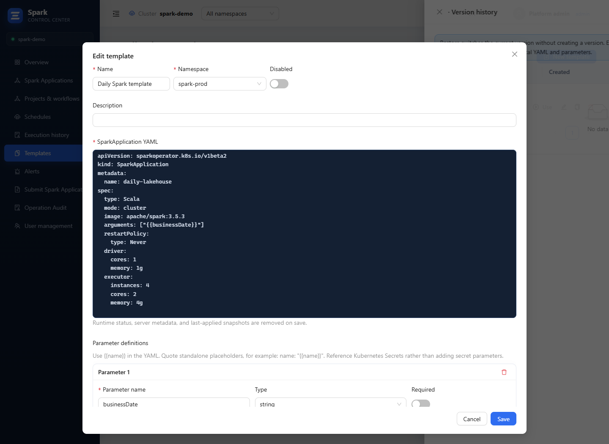
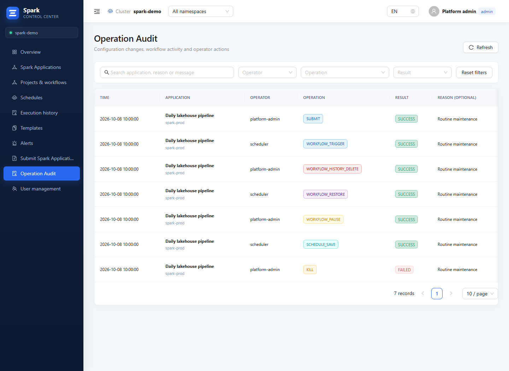
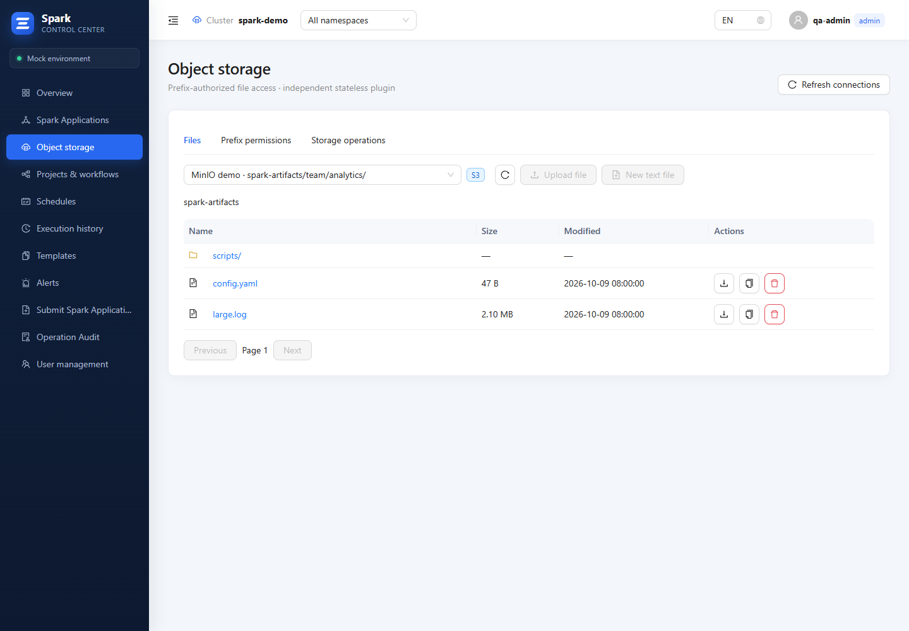
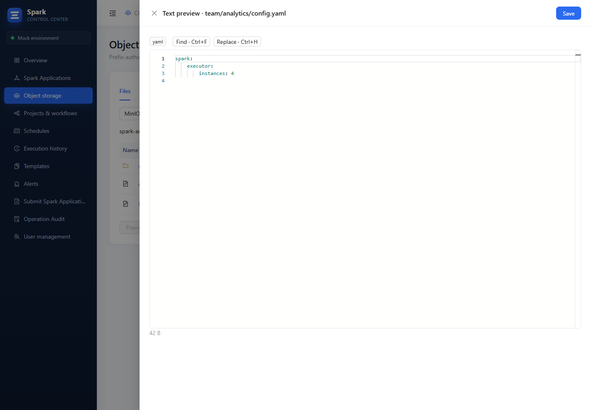

# Spark Control Center

[简体中文](README.zh-CN.md) · English

Spark Control Center is a web console for operating Apache Spark applications on Kubernetes. It combines application lifecycle operations, live and historical resource metrics, Driver UI access, persisted Executor logs, audit records, and role-based access in one deployable package.

## Highlights

- Discover SparkApplications across configured namespaces, with status, owner, lifecycle timestamps, and resource usage.
- Inspect Driver/Executor requests, live usage, peaks, scheduling, Kubernetes events, logs, YAML, and selectable Prometheus history ranges.
- Proxy a running Driver Spark UI through the backend; link terminal jobs to Spark History Server when event logging is enabled.
- Query retained Executor logs from Loki even after Kubernetes Pods are removed.
- Submit SparkApplication YAML, terminate `RUNNING` or stuck `SUBMITTED` jobs while retaining the failed Driver Pod, and delete terminal records.
- Validate submissions through Kubernetes server-side dry-run and compare the original YAML with the normalized manifest before creating it.
- Clone or retry an application from a sanitized manifest, with server-owned metadata and runtime status removed.
- Store cleaned YAML templates in PostgreSQL, define parameters with a form, and render typed manifests without storing Secret values. [Template guide](docs/en/TEMPLATES-AND-ALERTS.md).
- Share URL-backed application searches, use server-side paging/sorting and favorites, and preview permission-aware batch termination or deletion before execution.
- Configure versioned failure, long-pending, resource-pressure, repeated-retry, and extensible diagnostic-code alerts (including volume-mount failures); acknowledge, silence, recover, and optionally notify a generic webhook.
- Stream Kubernetes Watch changes to the browser over SSE, while retaining periodic refresh as a recovery path.
- Authenticate with PostgreSQL local accounts or optional OIDC/Keycloak; enforce tenant-defined module and namespace permissions in both UI and API.
- Persist users, sessions, lifecycle snapshots, failure diagnostics, and operation audit records in PostgreSQL.
- Deploy with the included Helm chart and namespace-scoped Kubernetes RBAC.
- Organize tenant-isolated projects, versioned DAG workflows and Spark YAML tasks; connect tasks by dragging ports and configure second-level timezone-aware Cron with dropdowns or preview/confirm backfills. [Workflow guide](docs/en/WORKFLOWS.md).
- Restore or permanently delete historical template/workflow versions, browse project-scoped execution histories, and recover orchestration state from PostgreSQL after backend replacement.

## Product views

### Application operations

| Overview | Resources and history |
| --- | --- |
|  |  |

### Workflows and automation

| Workflow and task editor | Scheduling |
| --- | --- |
|  |  |

### Configuration and governance

| Application templates | Operation audit |
| --- | --- |
|  |  |

See the [UI tour](docs/en/UI.md) for application, log, submission, alert and execution-history views.

### Object storage

| Authorized directories | Text editing |
| --- | --- |
|  |  |

## Documentation

- [Deployment and configuration](docs/en/DEPLOYMENT.md): containers, Helm, authentication, RBAC and observability.
- [Templates and alerts](docs/en/TEMPLATES-AND-ALERTS.md): YAML parameters, version management and diagnostic rules.
- [Workflows and scheduling](docs/en/WORKFLOWS.md): tenants, dependencies, Cron, backfills and persistence.
- [Security policy](docs/en/SECURITY.md): vulnerability reporting and deployment responsibilities.
- [Object storage](docs/en/OBJECT-STORAGE.md): optional S3/MinIO and GCS WIF plugin, prefix permissions and local validation.

## Architecture

- **Frontend:** React, TypeScript, Vite, Ant Design, ECharts
- **Backend:** Go HTTP service
- **Integrations:** Kubernetes Spark Operator API, Prometheus, Loki, PostgreSQL, optional OIDC
- **Deployment:** non-root container images, Nginx same-origin API proxy, Helm and scoped RBAC

The browser talks only to the same-origin `/api` endpoint. Kubernetes, Prometheus, Loki, PostgreSQL, and OIDC credentials remain server-side.

## Local development

Requirements: Node.js 22+ and npm.

```bash
npm ci
npm run dev
```

Local `npm run dev` uses browser-local mock data and mock authentication. Helm defaults use the real API and PostgreSQL login.

Run validation:

```bash
npm test
npm run build
```

Backend validation requires Go 1.24+:

```bash
cd backend
go test ./...
go vet ./...
```

## Container images

Build images without a registry prefix:

```bash
docker build -t spark-control-center:1.5.2 .
docker build -f backend/Dockerfile -t spark-control-center-backend:1.5.2 .
docker build -f object-storage/Dockerfile -t spark-control-center-object-storage:1.5.2 .
```

[Releases](https://github.com/ApolloMeridian/spark-application-webui/releases) contain three image TAR archives and one Helm TGZ package. Images have no private registry prefix. The optional storage image is included even when the feature is disabled; no checksum file is generated.

```bash
docker load -i spark-control-center-1.5.2.tar
docker load -i spark-control-center-backend-1.5.2.tar
docker load -i spark-control-center-object-storage-1.5.2.tar
```

## Helm deployment

Chart defaults are a complete production template using the real API and PostgreSQL login. Configure endpoints and existing Secrets in one file. Object storage and OIDC are disabled by default; Mock is available only through its explicit example:

```bash
helm show values ./spark-control-center-1.5.2.tgz > values-production.local.yaml

helm upgrade --install spark-console ./spark-control-center-1.5.2.tgz \
  --namespace spark-console \
  --create-namespace \
  -f values-production.local.yaml
```

Keep environment-specific deployment settings in an untracked values file. These settings include image locations, watched namespaces, database credential references, observability endpoints, Ingress, and identity-provider metadata.

Never commit actual credentials, access tokens, certificates, kubeconfigs, or production values.

See [Deployment and configuration](docs/en/DEPLOYMENT.md) for the complete interface, security model, RBAC behavior, Keycloak setup, and high-resolution Prometheus configuration.

## Permissions

- New `viewer` accounts enter the minimal `viewer` tenant: overview, applications, logs and Spark UI only.
- New `admin` accounts enter the full-access `admin` tenant and can manage users, tenants and audit records.
- Administrators configure module read/manage access, namespace access and Spark actions per tenant; viewer accounts can receive explicit operational permissions. Object storage additionally requires bucket/prefix/action grants.
- Existing user/project tenant assignments are preserved on upgrade. Legacy tenants retain previous access until explicitly configured. [Permission details](docs/en/WORKFLOWS.md).

The backend independently checks every privileged operation; hiding a UI button is not treated as authorization.

## Security

- No production credentials are included in this repository or container images.
- Passwords are bcrypt-hashed; random session tokens are stored only as SHA-256 hashes.
- Sessions use HttpOnly/SameSite cookies and state-changing API calls enforce same-origin checks.
- OIDC uses Authorization Code Flow with PKCE and validates issuer, signature, audience, expiry, state, and nonce.
- Kubernetes access is limited to explicitly configured namespaces by default.

## License

Licensed under the [Apache License 2.0](LICENSE).
