# UI tour

## Application operations

Start with the overview to inspect live resources and historical submission/failure totals, then filter applications by namespace, owner and state.

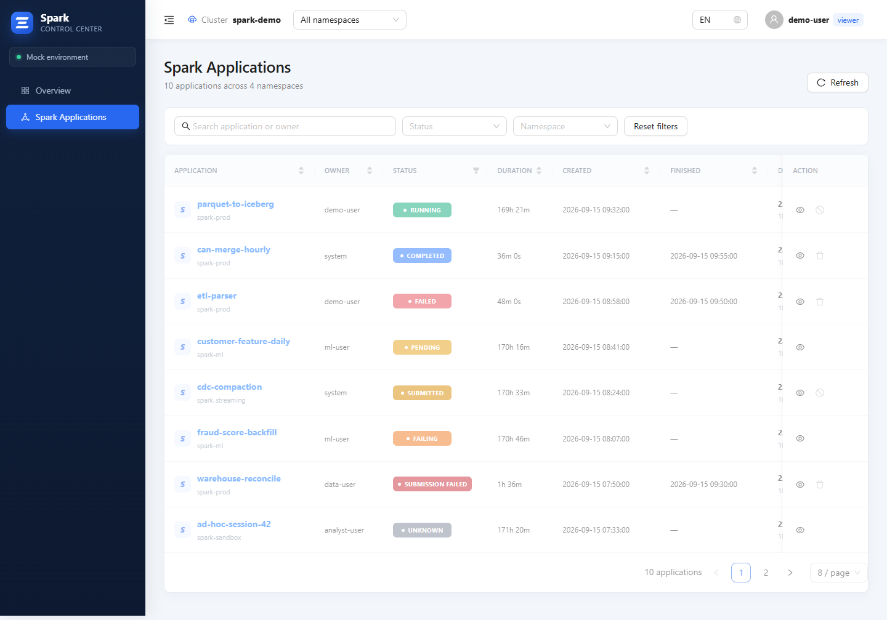

Open application details for Driver/Executor resources and selectable historical ranges. Persisted Executor logs support time filtering and ascending/descending order.

Driver logs support latest/range queries, previous/next line windows and Loki time filtering.

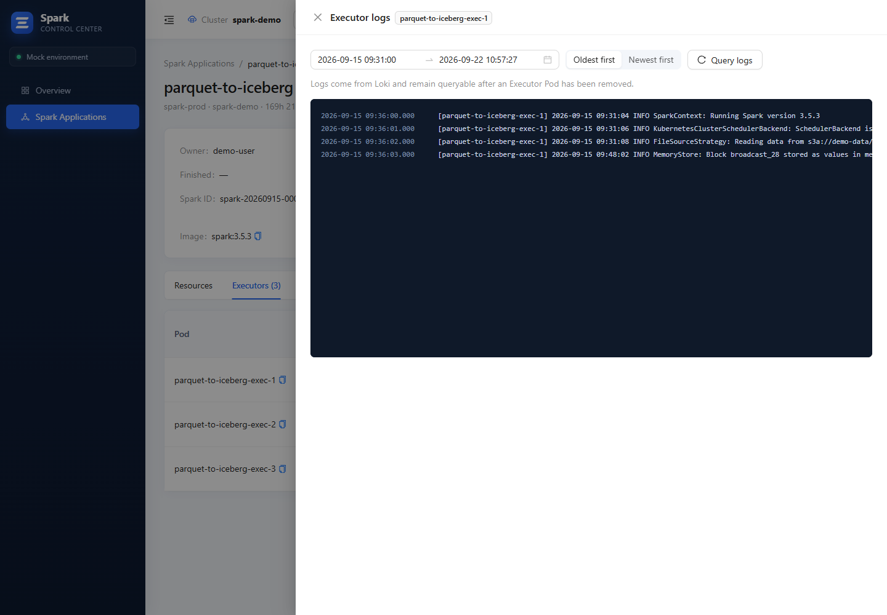

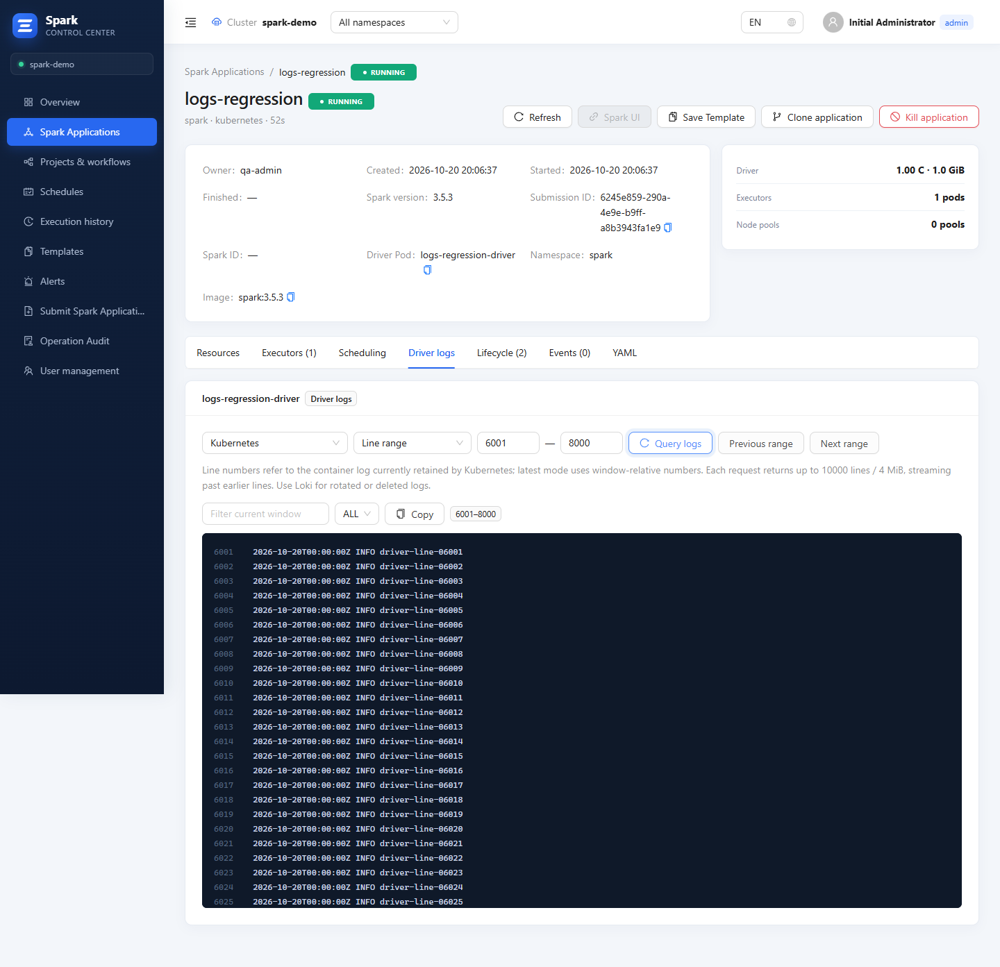

Administrators submit YAML after server-side validation and inspect the normalized manifest before creating an application.

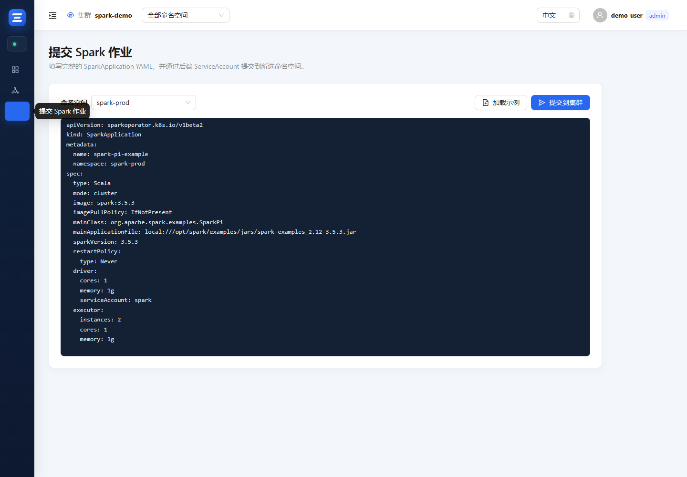

## Workflows and scheduling

Projects organize workflows and tasks. Drag task ports to build dependencies and configure typed parameter defaults, including logical-time expressions.

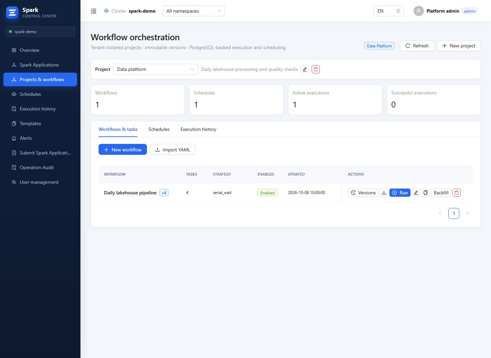

Configure second-level Cron using dropdowns or a custom expression. Preview executions within the validity window; use project-scoped histories to inspect workflow and task instances.

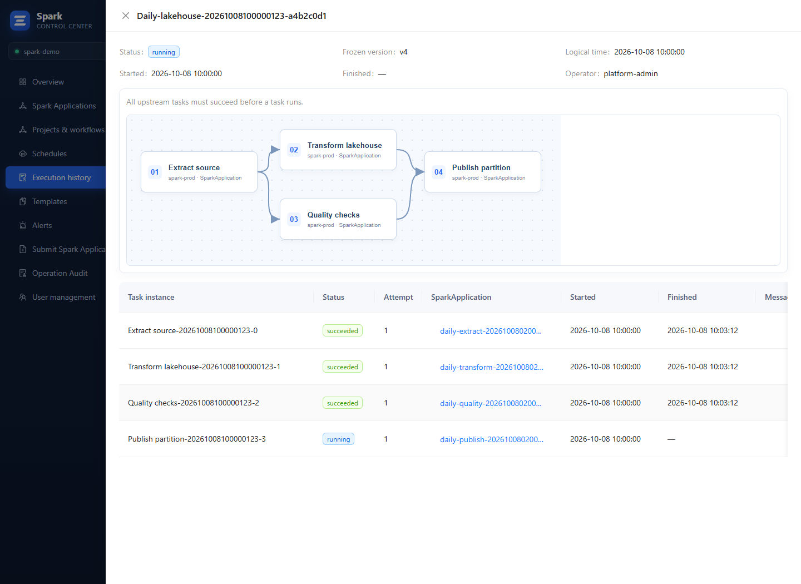

Backfill previews show the first 50 occurrences. Choose forward/reverse order and a failure policy, then confirm the entire range for durable serial execution.

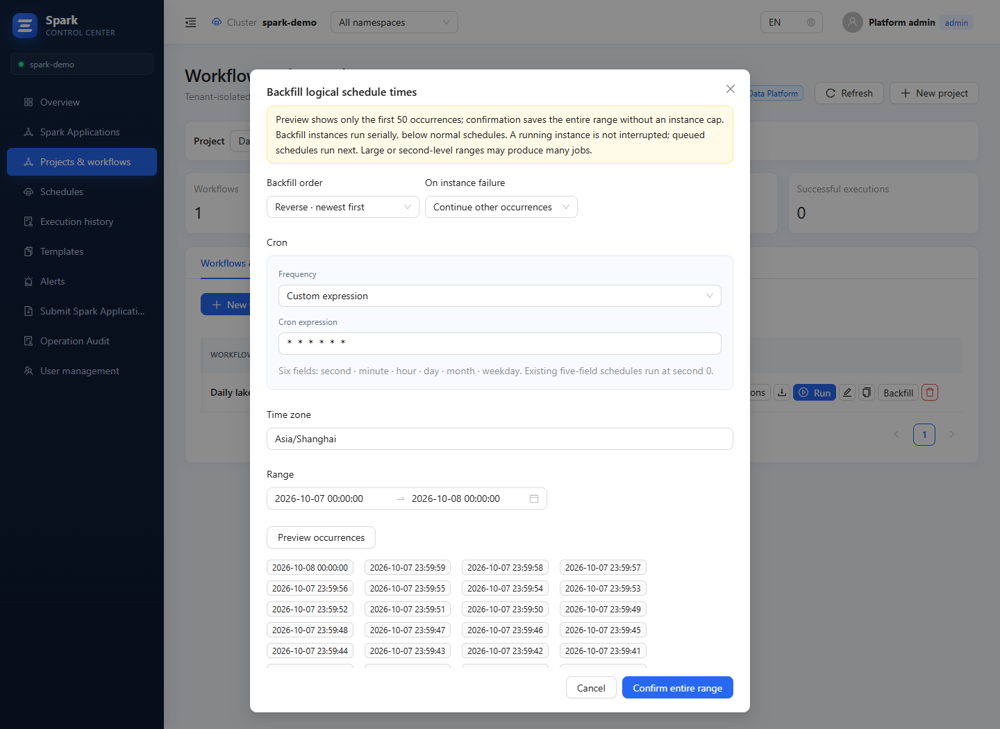

## Object storage

Create empty directories as drafts; they become persistent only when a file is written beneath them. Search file names and relative paths recursively within the current prefix; Next continues bounded scan batches. See [object-storage setup and permissions](OBJECT-STORAGE.md).

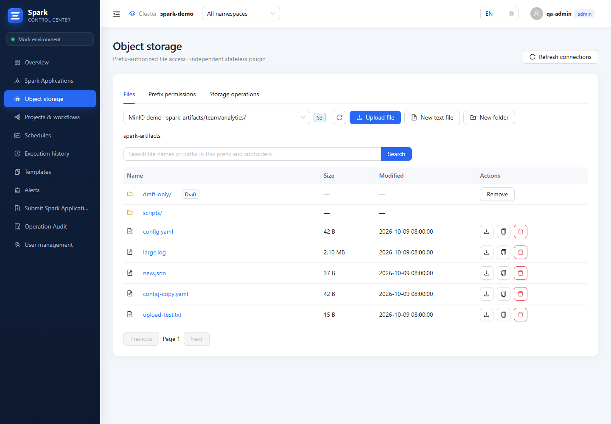

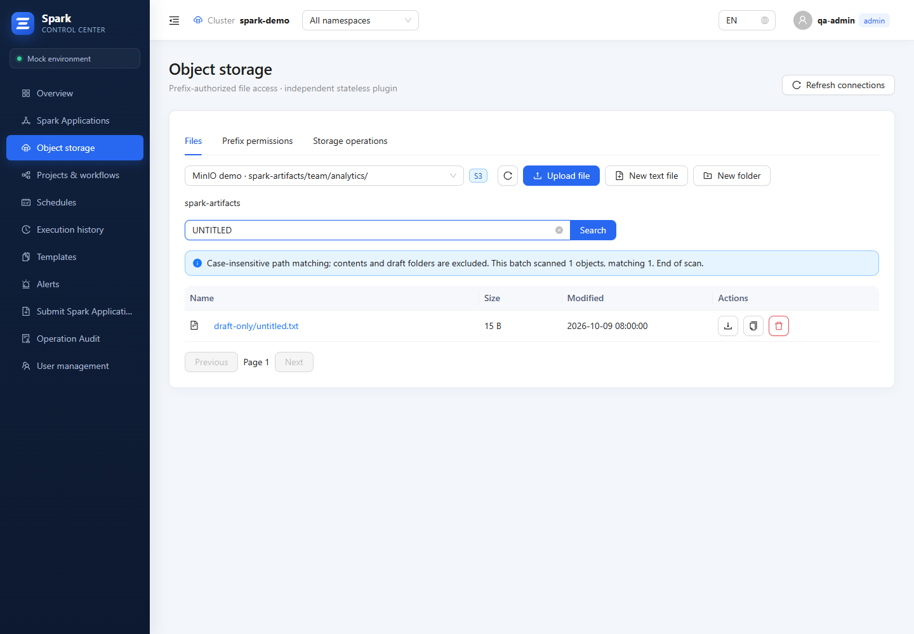

## Templates, alerts and governance

Reuse parameterized YAML templates and manage their versions. Diagnostic rules match observed or custom failure codes; alert evidence links back to application diagnostics.

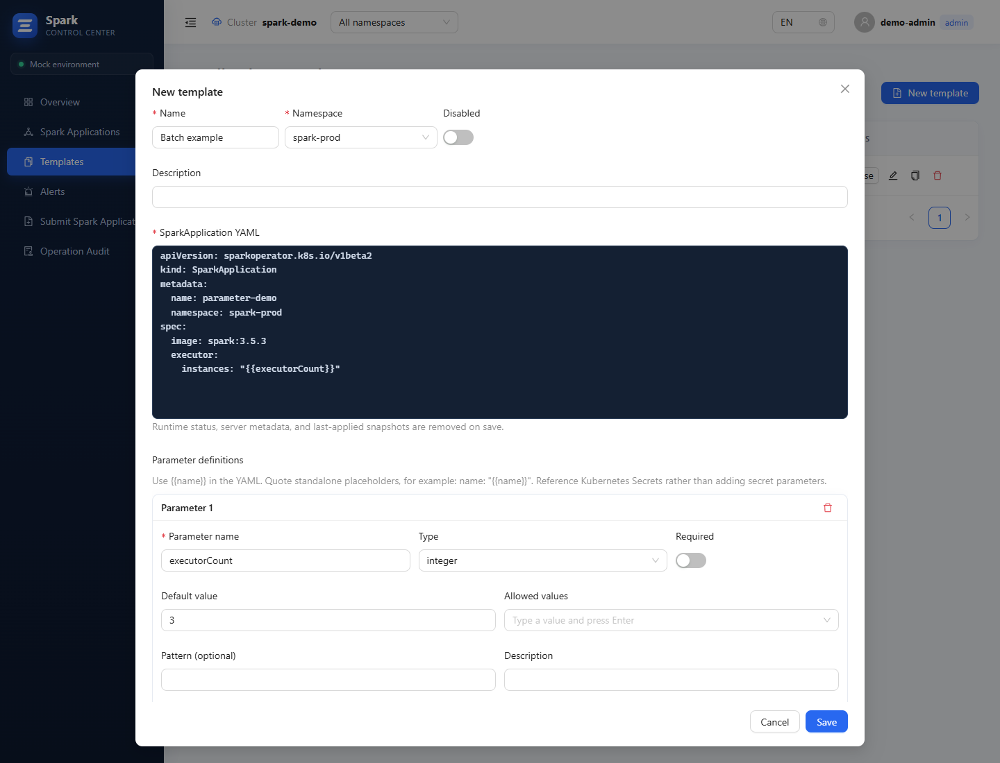

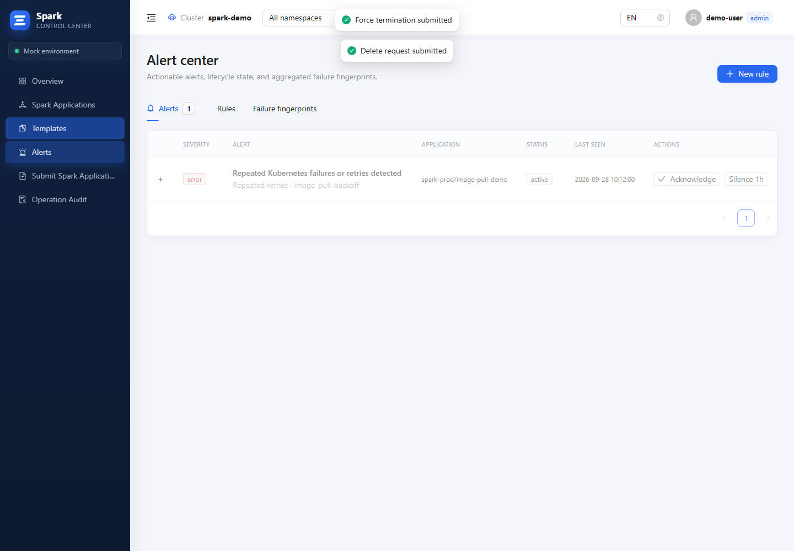

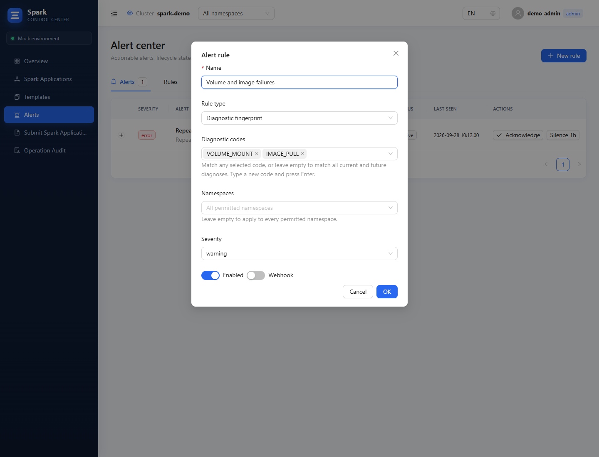

Filter audit records by operator, operation, result and keyword.

Manage accounts, namespace permissions and tenant assignments from User management.

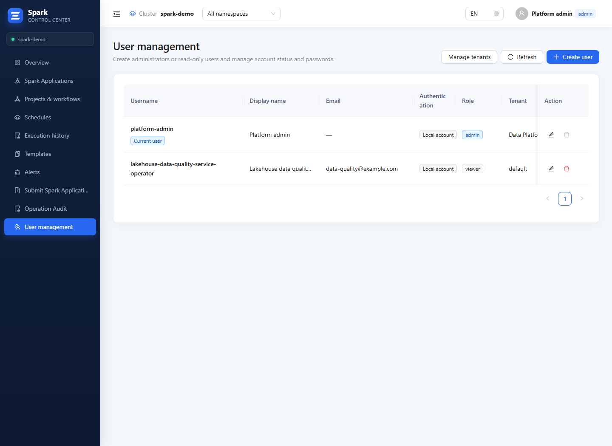

Return to the [English README](../../README.md).
